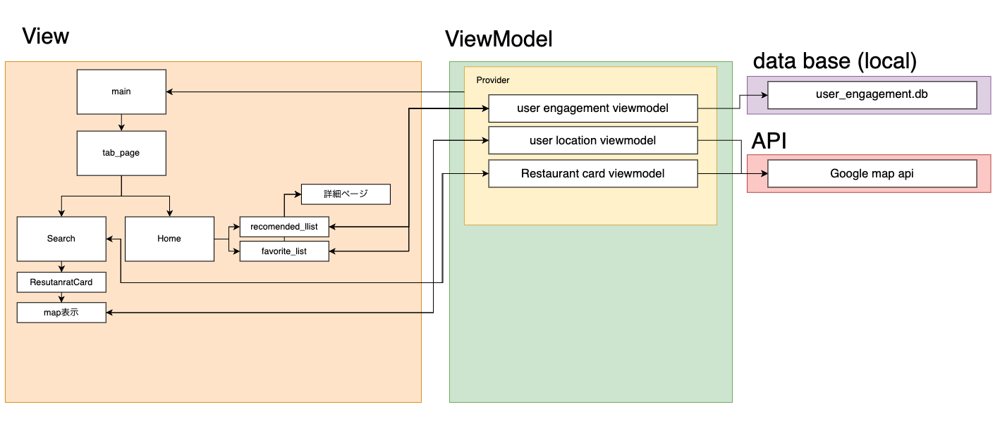

# Gohan - README

## 概要
Gohanは、従来のアプリやGoogle Mapsでは見つけにくいレストランを、写真を通じて簡単に探せる新しいグルメアプリです。

## フロー
最新のフローは`flow.drawio`ファイルを[drawio](https://app.diagrams.net/)で確認してください。


## Git命名規則

### コミットメッセージのルール
Gohanのコミットメッセージは[Conventional Commits](https://www.conventionalcommits.org/en/v1.0.0-beta.4/)に従って作成します。

| タイプ    | 内容                                                         | 
| -------- | -------------------------------------------------------------- | 
| chore    | ビルドプロセスの変更、補助ツールやライブラリの追加・変更        | 
| ci       | CIの設定やスクリプトの変更                                      | 
| docs     | ドキュメントのみの変更                                          | 
| feat     | 新機能の追加                                                    | 
| fix      | バグ修正                                                        | 
| refactor | リファクタリング                                                | 
| style    | コードフォーマットの変更                                        | 
| test     | テストコードの追加、リファクタリング                            | 
| perf     | パフォーマンス向上コード                                        | 

**例:** `feat: ログイン機能の実装`

## アプリの初期設定
- 環境構築が完了している前提で進めます。

## インストール手順

1. リポジトリをクローンし、クローンしたディレクトリに移動します。
   ```bash
   flutter pub get
   ```

2. うまくいかない場合、以下のコマンドでクリーンを試してみてください。
   ```bash
   flutter clean
   flutter pub get
   ```

## 環境変数の設定

### Firebase
Firebaseを使用してログインとFirestoreへの書き込みを行います。毎回ログインが求められて煩わしい場合は、[wrapper.dart](lib/wrapper.dart)を参照して変更してください。

1. `lib/config`ディレクトリに`firebase_options.dart`を追加します。

#### iOS設定
- `ios/Runner/`ディレクトリに`GoogleService-Info.plist`を追加します。
- Xcodeでビルドが通らない場合は、`Bundle Identifier`を見直してください。

#### Android設定
1. `android/app/`ディレクトリに`google-services.json`を追加します。
2. 以下のコマンドを実行します。
   ```bash
   cd android
   ./gradlew signingReport
   ```
3. コマンド実行後に表示される**SHA1**をコピーし，firebaseに自分で追加するか **@kai** で知らせてください

参考: [Zenn記事](https://zenn.dev/tsukatsuka1783/articles/flutter_firebase_auth_google_sign_in)

### レストランデータ取得用環境変数の設定
1. ルートディレクトリに`.env`ファイルを作成し、以下の内容を追加します。
   ```
   GOOGLE_MAPS_API_KEY=APIキー
   ```
2. `.env`が`.gitignore`に含まれていることを確認します。

#### iOS設定
- `ios/Runner/Environment.swift`をXcodeで作成し、以下の内容を追加します。
   ```swift
   import Foundation

   struct Env {
       static let googleMapApiKey = "APIキー"
   }
   ```

#### Android設定
1. `android/secret.properties`ファイルを作成し、以下の内容を追加します。
   ```
   googleMap.apiKey=各自のAPIキー
   ```

### Kotlinバージョン設定
Kotlinのバージョンを明記しないとエラーが発生する可能性があるため、`android/app/build.gradle`の最初に以下を追加します。

```gradle
plugins {
    id "com.android.application"
    id "kotlin-android"
    id "dev.flutter.flutter-gradle-plugin"
    id "org.jetbrains.kotlin.android" version "1.9.0" apply true // ここを追加
}
```

## エラー表示システムの使用方法

### エラー表示
エラーを表示するには、`ErrorHandler`クラスの`handleError`メソッドを使用します。

```dart
import 'package:gohan/components/error_overlay/error_handler.dart';

void someFunction() {
  try {
    // エラーが起きる可能性のある処理
  } catch (e) {
    ErrorHandler().handleError(AppError(
      message: 'エラーが発生しました: $e',
      type: ErrorType.unknown, // デフォルト
      action: () {
        print('エラーアクションが実行されました');
      },
      additionalActions: {
        '再試行': () {
          print('再試行アクションが実行されました');
          // 再試行ロジックを追加
        },
      },
    ));
  }
}
```

### エラータイプの定義
新しいエラータイプを追加するには、`error_handler.dart`内の`ErrorType`列挙型を拡張します。

```dart
enum ErrorType { network, validation, unknown, ... }
```

次に、`error_styles.dart`内の`getTitleForErrorType`メソッドに追加したエラーのタイトルを追加します。

```dart
String getTitleForErrorType(ErrorType type) {
  switch (type) {
    case ErrorType.network:
      return 'ネットワークエラー';
    case ErrorType.validation:
      return '入力エラー';
    ...
    case ErrorType.unknown:
    default:
      return 'エラー';
  }
}
```
余裕があればこっちも
```dart
IconData getIconForErrorType(ErrorType type) {
  switch (type) {
    case ErrorType.network:
      return Icons.wifi_off;
    case ErrorType.validation:
      return Icons.error_outline;
    ...
    case ErrorType.unknown:
    default:
      return Icons.warning_amber;
  }
}

Color getColorForErrorType(ErrorType type) {
  switch (type) {
    case ErrorType.network:
      return Colors.blue;
    case ErrorType.validation:
      return Colors.orange;
    ...
    case ErrorType.unknown:
    default:
      return Colors.red;
  }
}
```